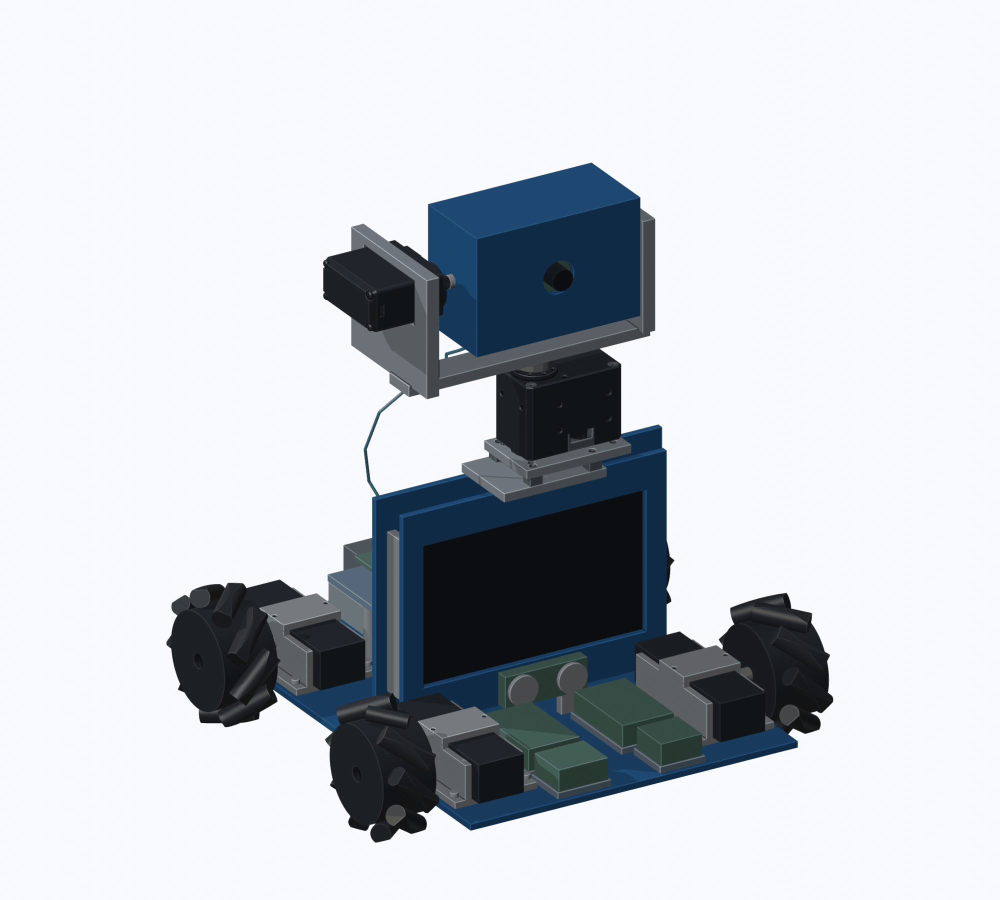
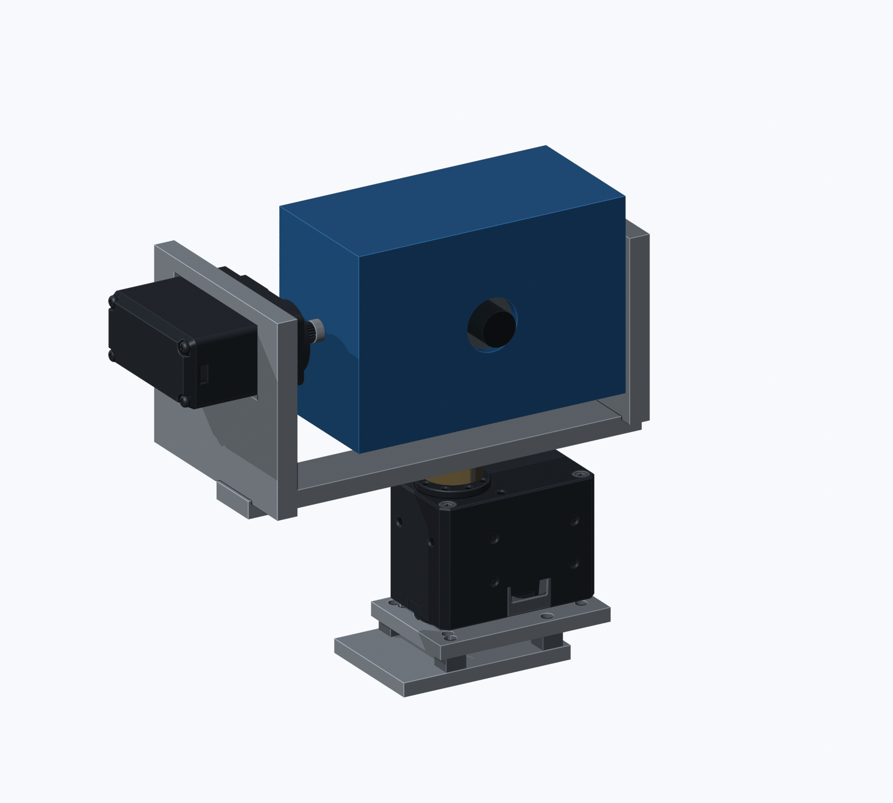

# RoverBuddy X1

RoverBuddy X1 is a small robot designed to follow a person using a camera. It has four mecanum wheels, a moving camera head and a screen on its chest.

## What it is supposed to do

- Move forward, backward and sideways.
- Follow a selected person using the camera.
- Detect obstacles and stop when needed.
- Show information on the chest screen.

These are project goals. The robot has not been built or tested on hardware yet.

## 3D design

[Open the Onshape model](https://cad.onshape.com/documents/6810cacad94ccaed2254a4c9/w/506e2971336fa1f66d037230/e/09c7e032cc91bfb2e46e0e5d)

[Download the STEP model](https://raw.githubusercontent.com/Umair-Coder124/RoverBuddy-X1-verified/main/cad/RoverBuddy_X1_Full_Pan_Tilt_Fit_Study.step)

The Onshape model contains an earlier import. The latest design study and its limitations are explained in the [CAD notes](cad/README.md) and [mounting review](cad/2026-11-21-mounting-review.md).

## Main parts

| Part | What it does |
| --- | --- |
| Raspberry Pi 5 | Handles the camera and display |
| Raspberry Pi Pico 2 | Controls the motors |
| Camera Module 3 | Detects people |
| Four mecanum wheels and motors | Move the robot |
| XM430 and D645MW servos | Turn and tilt the head |
| Ultrasonic sensor | Helps detect nearby obstacles |
| Battery and power modules | Supply power |

The [parts list (BOM)](bom.csv) has supplier links and estimated costs. The provisional subtotal is **US$1,533.29** for 53 priced rows; four rows are still unpriced. Shipping, local availability, protection hardware and final compatibility are not confirmed.

## Wiring

The Raspberry Pi processes camera information, while the Pico handles the proposed drive controls. The head uses separate pan and tilt connections and power supplies.

[Full wiring diagram](docs/wiring_draft.svg) · [Detailed wiring and safety notes](docs/WIRING.md)

**Safety:** The wiring is a draft. Do not power the robot or enable its motors until the battery protection, wiring, isolation and actuator controls have been checked with qualified adult supervision.

## Code and testing

The [firmware folder](firmware/README.md) contains the desktop simulations and test instructions.

The documented desktop test run passed 77 tests. These are software and mocked tests, not proof that the physical robot works. Real camera tracking, head control and driving still need hardware integration and testing. Motor outputs remain disabled by default.

## Progress

- [x] Design study and CAD previews
- [x] Draft wiring diagram and software simulation
- [x] Review the listed component prices
- [ ] Finish mounting and camera cable checks
- [ ] Confirm the remaining power and safety components
- [ ] Confirm delivered component costs and the submission requirements
- [ ] Assemble and test the robot
- [ ] Record a working demo

## Project files

- [CAD details](cad/README.md)
- [Parts list](bom.csv)
- [Wiring details](docs/WIRING.md)
- [Software and tests](firmware/README.md)
- [November 20 review](docs/2026-11-20-design-review.md)
- [November 21 component and build plan](docs/2026-11-21-procurement-review.md)
- [November 21 mounting review](cad/2026-11-21-mounting-review.md)
