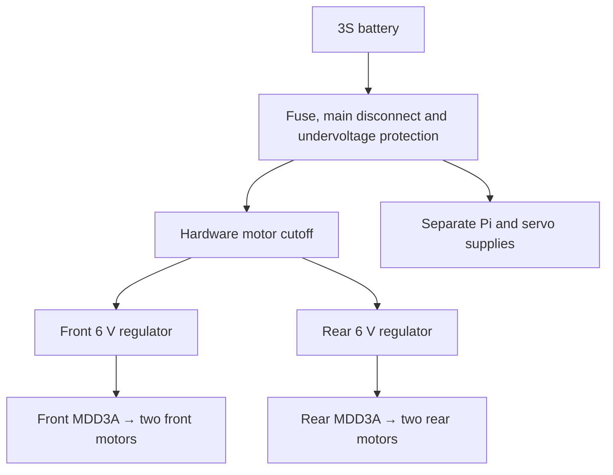
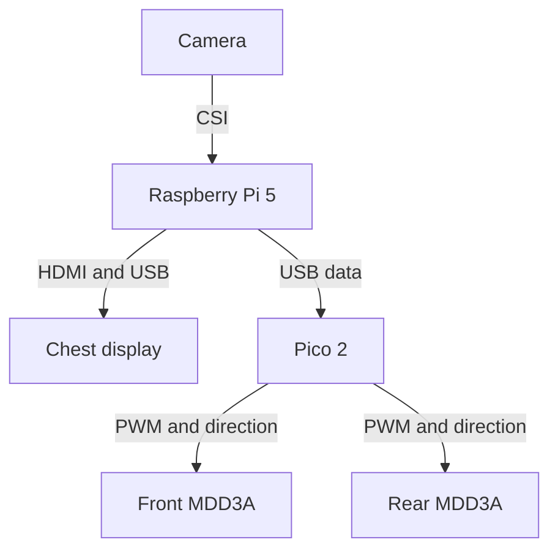

# RoverBuddy X1

RoverBuddy X1 is a design for a camera-guided companion robot. Four mecanum wheels let it drive sideways as well as forward and backward. A camera in the moving head is intended to track a person, and the chest display is intended to show status. The project combines computer vision, motion control and a custom chassis.

## 3D model

[Open RoverBuddy X1 3D Model in Onshape](https://cad.onshape.com/documents/6810cacad94ccaed2254a4c9/w/506e2971336fa1f66d037230/e/09c7e032cc91bfb2e46e0e5d)

The existing Onshape document shows the earlier imported geometry. Its STEP import still needs updating to match the latest repository assembly.

Preview finishes distinguish the blue shell, silver brackets and dark actuator housings. These are CAD study renders; physical assembly and fit checks remain pending.

The integrated study combines the lower camera cable centerline with a Pi 5 tray using a 58 × 49 mm mounting pattern. The board is shifted 3 mm toward negative X in this study. [Rear view of the cable route and Pi tray](cad/Integrated_Rear_Preview.png).

The cable route was screened in 65 sampled poses over ±180° pan and an assumed ±30° tilt. These checks apply to the modeled centerline and component envelopes. The longest sampled route was approximately 342 mm before the internal camera run, connector exits and service slack. A 500 mm Standard-Mini ribbon is the candidate for a physical fit check. Actual ribbon width, bend radius, strain relief, actuator mounts and connector access still need checking.

[Download the current STEP assembly file](https://raw.githubusercontent.com/Umair-Coder124/RoverBuddy-X1-verified/main/cad/RoverBuddy_X1_Full_Pan_Tilt_Fit_Study.step) · [CAD files and revision notes](cad/README.md)

The STEP link downloads the CAD source for import into Onshape or another CAD application.

## Wiring and control

### Power distribution

### Signal connections

The diagram shows the planned connections. The [wiring notes](docs/WIRING.md) include the proposed [Pico GPIO table](docs/WIRING.md#proposed-logical-gpio-allocation), the [front](docs/WIRING.md#motor-driver-1--front-wheels) and [rear](docs/WIRING.md#motor-driver-2--rear-wheels) motor-driver connections, and the battery protection and motor cutoff design. Component ratings and hardware validation are still pending.

The [firmware instructions](firmware/README.md) explain how to run the drive simulator. The planned workflow uses the camera to select a target and the controller to drive the four motors. End-to-end follow mode and hardware testing are pending.

## Design submission readiness

The drive controller passed five desktop tests and a simulated watchdog stop. The [serial parser fix](https://github.com/Umair-Coder124/RoverBuddy-X1-verified/commit/4406fdf8919625282004607cfbc282fbfebdae76) also passed a desktop check that an oversized line is discarded and the next valid line is accepted. Motor outputs are disabled by default.

- [x] Publish the November 15 full assembly STEP and CAD previews in the repository.
- [x] Check raised head and camera geometry against the imported pan-actuator envelope through ±180° in a separate CAD study. See the [fit result](docs/WIRING.md#raised-pan-adapter-fit-study).
- [ ] Finalize the shaft coupling and tilt mount, then check fastener access, connector clearance and camera ribbon travel in the assembled layout.
- [ ] Finalize the battery disconnect, hardware motor cutoff, fuse and servo supply ratings. Update the wiring and BOM together.
- [x] Reconcile the priced BOM lines to the provisional subtotal.
- [ ] Add exact links and costs for the selected power-protection hardware, identify the owned screwdrivers if possible, and confirm delivered costs.
- [ ] Confirm which CAD and firmware reference files, if any, Fallen accepts in the actual design submission. The organizer feedback reported so far addressed the wiring diagram and rollers.

## BOM and submission

The [Fallen BOM](bom.csv) requests **US$1,225.67** for 52 priced lines, including two matching batteries and one balance charger. Unit prices were converted at 3.75 SAR per USD and rounded before calculating line totals. The second battery is an offboard spare. The import excludes owned tools, parts included in other purchases, unpriced power-protection hardware and delivery. The [original cost estimates and item notes](https://github.com/Umair-Coder124/RoverBuddy-X1-verified/blob/4988d37e5a4969cd980270fd1a0d975400de9bfd/bom.csv) retain the SAR prices and pending items. Confirm pricing, stock and shipping before ordering. Battery protection, hardware isolation and bench validation remain open.

The [Fallen submission guide](https://fallen.hackclub.com/docs/submitting) calls for a finished entrant-designed digital project at the funding stage. Untested firmware is acceptable at that stage, and the physical build and demo are assessed at the build stage. Fallen's rules require entrants to design and document their own work. Ask the organizers whether any reference material can be reused, complete and document your own work, and check the submission requirements before sending the project for review.

