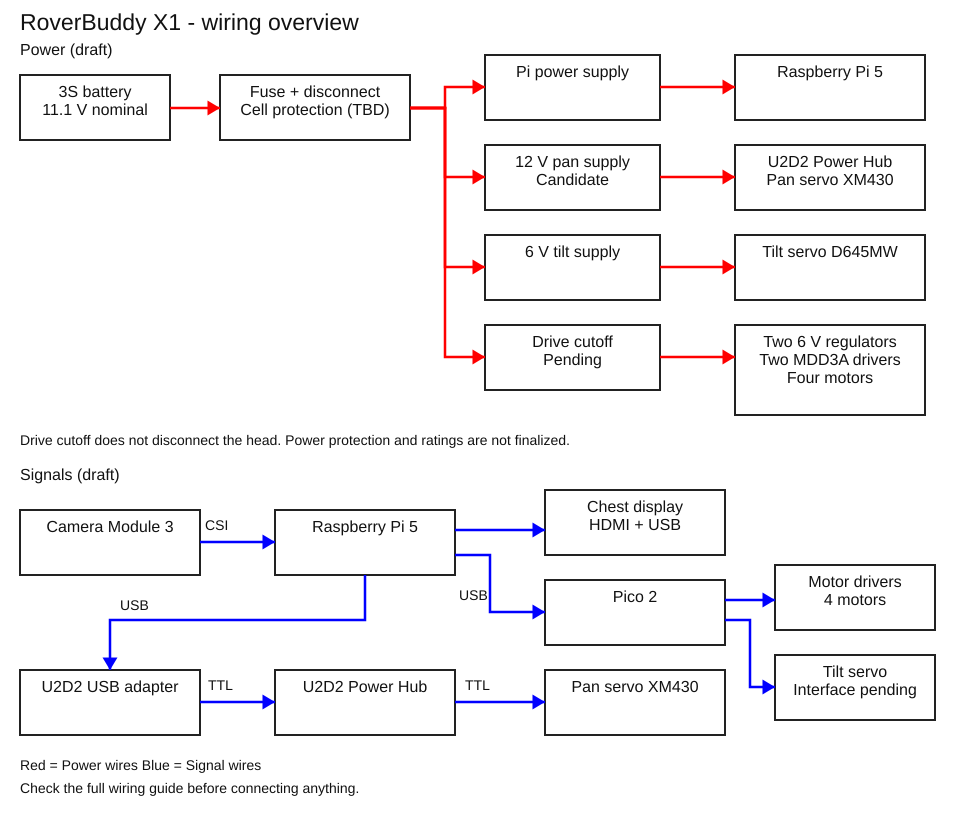

# RoverBuddy X1

RoverBuddy X1 is a robot designed to follow me using a camera. I chose this project because I always wanted to build a robot.

My last project was an ESP32-CAM surveillance car that I could control with my phone. The camera quality was bad, it often disconnected, and it took a long time to connect. It also didn't have obstacle detection or automatic stops.

For RoverBuddy X1, I want to improve on those problems. I chose a Raspberry Pi, a better camera, mecanum wheels and a metal pan-and-tilt setup for the camera.

## What it is supposed to do

- Move forward, backward and sideways.
- Let me control it from my phone or laptop.
- Follow a selected person using the camera.
- Detect obstacles and stop when needed.
- Show information on the chest screen.

I've finished the main digital design and planning, but I'm still waiting to get the parts so I can start building. Some design checks are still open. These are planned features, not tested hardware features yet.

## How it works

The Raspberry Pi 5 is the robot's brain. It processes the camera images and decides what movement to request. The Pico 2 receives those instructions and controls the motors.

The mecanum wheels allow the robot to move forward, backward and sideways, turn, or combine those movements. The camera helps the software locate the person I select for it to follow.

The ultrasonic sensor measures the distance to obstacles in front of the robot so it can stop when something is too close. The pan-and-tilt servos let the camera look up, down, left and right. The chest screen is for displaying information about the robot.

This is how I plan for the robot to work. Real movement, obstacle detection and following still need to be tested.

## 3D design

At first I wanted the robot to be like my ESP32 surveillance car, with just a moving camera and no display. Later I got the idea of adding a screen on the chest so it would be easy to see the robot's status.

I based the lower body on my old car, put the screen above it and placed the camera head on top. Mars rovers inspired the design. I chose four wheels for balance and movement, although these mecanum wheels are intended for reasonably flat ground.

This was my first time using Onshape. I ran into geometry errors, trouble positioning the head, and problems with extrusion thickness. Sometimes a part came out as thick as a book, sometimes as thin as paper. I kept working through these issues until the main design came together. Some mounting and clearance checks are still left.

Onshape model: https://cad.onshape.com/documents/6810cacad94ccaed2254a4c9/w/506e2971336fa1f66d037230/e/09c7e032cc91bfb2e46e0e5d

STEP model: https://raw.githubusercontent.com/Umair-Coder124/RoverBuddy-X1-verified/main/cad/RoverBuddy_X1_Full_Pan_Tilt_Fit_Study.step

The Onshape model contains an earlier import. The latest design study and its limitations are explained in the [CAD notes](cad/README.md) and [mounting review](cad/2026-11-21-mounting-review.md).

## Main parts

| Part | What it does |
| --- | --- |
| Raspberry Pi 5 | Handles the camera and display |
| Raspberry Pi Pico 2 | Controls the motors |
| Camera Module 3 | Detects people |
| Four mecanum wheels and motors | Move the robot |
| XM430 and D645MW servos | Turn and tilt the head |
| Ultrasonic sensor | Helps detect nearby obstacles |
| Battery and power modules | Supply power |

The [parts list (BOM)](bom.csv) has supplier links and estimated costs. The provisional subtotal is **US$1,533.29** for 53 priced rows; four rows are still unpriced. Shipping, local availability, protection hardware and final compatibility are not confirmed.

## Why I chose these electronics

In my old ESP32 project, I would be controlling the car and suddenly everything would stop. I had to go over to the car and restart it. Even after restarting, the video was laggy and shaky, and the car kept disconnecting from my phone. That's why I wanted to try a Raspberry Pi and a different camera this time.

I also used a plastic pan-and-tilt setup on the old project. After using it for a while, the plastic wore out. For this robot I'm planning to use metal parts for the moving camera head instead.

Working on my previous projects taught me how important electrical safety is. I damaged motors while learning to solder and had problems when working with batteries. I want to avoid those mistakes in this build, so I am planning to use a preassembled lithium battery pack and have the wiring, charger, protection and motor controls checked before connecting power.

## Wiring

The Raspberry Pi processes camera information, while the Pico handles the proposed drive controls. The head uses separate pan and tilt connections and power supplies.

Wiring diagram: https://github.com/Umair-Coder124/RoverBuddy-X1-verified/blob/main/docs/wiring_overview.svg

Wiring notes: https://github.com/Umair-Coder124/RoverBuddy-X1-verified/blob/main/docs/WIRING.md

**Safety:** The wiring is a draft. Do not power the robot or enable its motors until the battery protection, wiring, isolation and actuator controls have been checked with qualified adult supervision.

## Code and testing

I've used C++ and Python before. For my ESP32 car, I used basic C++ to program the controls.

For RoverBuddy, I want to make a web page that opens on a phone. The idea is to control the robot manually, or switch to a follow-me mode and put the phone away. I would also like to explore a supervised patrol mode in the future, for use in places where I have permission.

These are software goals for the build. The phone interface and real-world following and patrol functions have not been completed or tested yet.

The [firmware folder](firmware/README.md) contains the desktop simulations and test instructions.

The documented desktop test run passed 77 tests. These are software and mocked tests, not proof that the physical robot works. Real camera tracking, head control and driving still need hardware integration and testing. Motor outputs remain disabled by default.

## Progress

- [x] Design study and CAD previews
- [x] Draft wiring diagram and software simulation
- [x] Review the listed component prices
- [ ] Finish mounting and camera cable checks
- [ ] Confirm the remaining power and safety components
- [ ] Confirm delivered component costs and the submission requirements
- [ ] Assemble and test the robot
- [ ] Record a working demo

## Project files

- [CAD details](cad/README.md)
- [Parts list](bom.csv)
- [Wiring details](docs/WIRING.md)
- [Software and tests](firmware/README.md)
- [November 20 review](docs/2026-11-20-design-review.md)
- [November 21 component and build plan](docs/2026-11-21-procurement-review.md)
- [November 21 mounting review](cad/2026-11-21-mounting-review.md)
