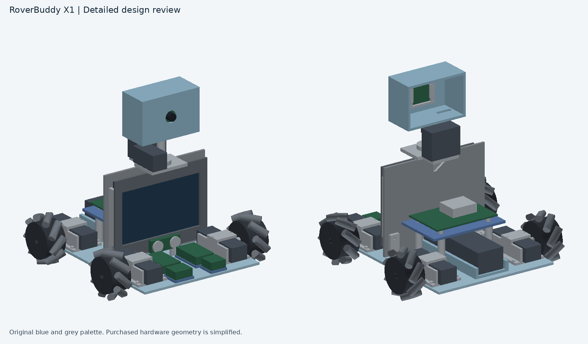
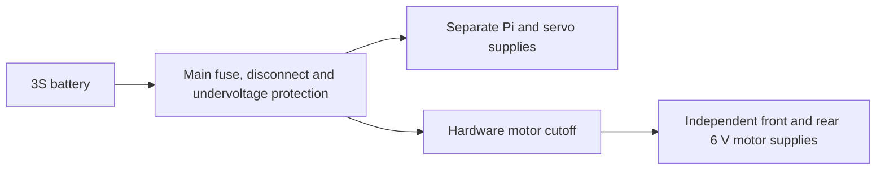

# RoverBuddy X1

RoverBuddy X1 is a design for a camera-guided companion robot. Four mecanum wheels let it drive sideways as well as forward and backward. A camera in the moving head is intended to track a person, and the chest display is intended to show status. The project combines computer vision, motion control and a custom chassis.

## CAD

[Open the latest Onshape revision](https://cad.onshape.com/documents/7af13938ef1c0698d1f50b49/w/3e6d69d20d18f8a901bda826/e/d6c90a986fc1453722e99382)

The [CAD notes](cad/README.md) describe the wheel and motor mounts, camera carrier and electronics placement. The full assembly STEP and 131 individual STEP files are in [cad](cad/). Purchased component envelopes are identified in the [parts manifest](cad/Parts_Manifest.csv). The STEP revision replaces `Roller_Rear_L_03` and `Roller_Front_R_03` with simplified representations of the purchased wheel rollers. The repaired import opened without the previously reported warnings in the project owner’s Onshape session. Hardware fit still needs confirmation.

## Wiring and intended use

Sophia confirmed that a wiring diagram is acceptable for this module-based design. See the [wiring draft](docs/WIRING.md) and [firmware instructions](firmware/README.md). Use the firmware simulator to try the drive logic. The intended physical workflow is to select a target through the camera system, then use the controller to command the four motors. Hardware testing and an end-to-end follow mode are pending.

## Design submission readiness

The drive controller passed five desktop tests and a simulated watchdog stop. The [serial parser fix](https://github.com/Umair-Coder124/RoverBuddy-X1-verified/commit/4406fdf8919625282004607cfbc282fbfebdae76) also passed a desktop check that an oversized line is discarded and the next valid line is accepted. Motor outputs are disabled by default.

- [ ] Confirm the repaired Onshape tab loads and rotates from the public link.
- [x] Check raised head and camera geometry against the imported pan-actuator envelope through ±180° in a separate CAD study. See the [fit result](docs/WIRING.md#raised-pan-adapter-fit-study).
- [ ] Finalize the shaft coupling and tilt mount, then check fastener access, connector clearance and camera ribbon travel in the assembled layout.
- [ ] Finalize the battery disconnect, hardware motor cutoff, fuse and servo supply ratings. Update the wiring and BOM together.
- [ ] Fill any missing purchase links and confirm delivered costs.
- [ ] Confirm with Fallen which existing reference files may be included.

## BOM and submission

The [BOM](bom.csv) includes two matching battery packs and one balance charger. The indicative priced subtotal is 4,596.18 SAR (1,225.65 USD at 3.75 SAR per USD), excluding unpriced protection parts and delivered costs. Fill in missing purchase links and mark owned parts. Confirm pricing, stock and shipping before ordering. The draft specifies the official Pico 2 pinout and separate front and rear motor supplies. Battery protection, hardware isolation and bench validation remain open. The overview above shows the proposed power architecture.

This is a review package with AI-assisted reference material. Fallen's rules require entrants to design and document their own work. Ask the organizers whether any reference material can be reused, complete and document your own work, and check the submission requirements before sending the project for review.
