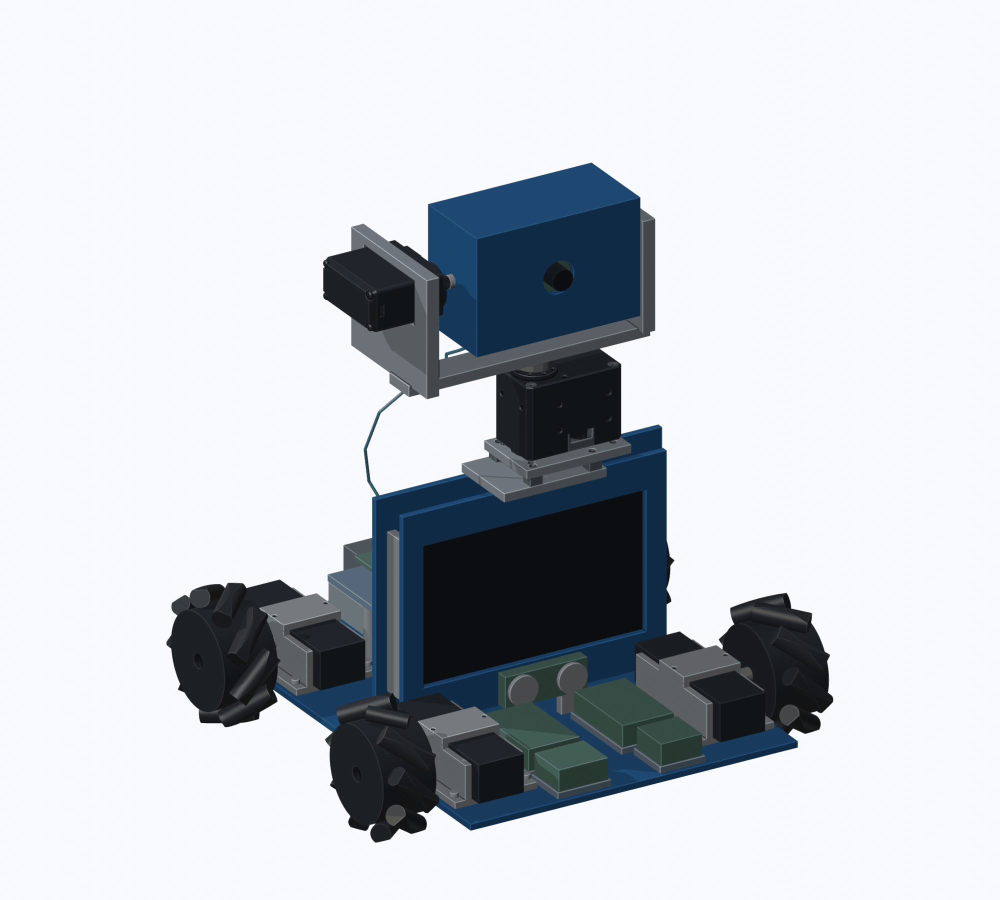

# 3D model

[Latest STEP model](RoverBuddy_X1_Full_Pan_Tilt_Fit_Study.step) · [Head preview](Head_Camera.png) · [Rear preview](Integrated_Rear_Preview.png)

Import the STEP with appearances enabled. The Onshape import is an earlier revision and still needs comparison with the latest STEP.

## Main parts

- Base with four wheels, motor brackets and battery tray.
- Raspberry Pi tray, electronics space and chest display.
- Moving head with a camera and pan-and-tilt servo mounts.

## Measurements to check

| Part | Design measurements |
| --- | --- |
| Pi tray | 58 × 49 mm board mounting pattern |
| Battery space | 108 × 35 × 27 mm reference envelope |
| Chest display | 121 × 89.48 mm reference envelope |
| Camera cable | 342 mm longest sampled route; 500 mm cable candidate |
| Pan mount | 41 mm raised gap; 42.7 mm actuator reference envelope |
| Pan power board | 70 × 39 × 32 mm candidate enclosure |

These are model measurements. Check actual parts and clearances before printing or assembly.

[Parts manifest](Parts_Manifest.csv) · [Interference check](Interference_Check.csv) · [Earlier detailed STEP](RoverBuddy_X1_Detailed_Assembly.step)

See the [build checklist](../docs/build-checklist.md) for remaining checks and the [full CAD reference](https://github.com/Umair-Coder124/RoverBuddy-X1-verified/blob/d836ea650516e329bdd500ddd6cfbd0f682dbf04/cad/README.md) for measurements, supplier drawings and earlier model details.
