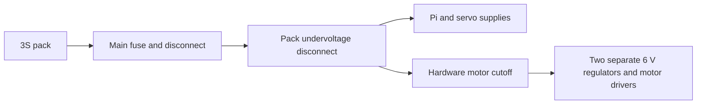

# Wiring draft — engineering review required

This diagram shows the intended architecture. It is not a validated electrical schematic. Do not wire or energize the robot from this diagram alone.

## Power architecture

The selected assembled 3S battery reaches 12.6 V fully charged. A suitably rated fuse, disconnect, automatic low-voltage protection and hardware drive isolation must be specified before the power distribution is finalized. The current emergency-stop candidate is not approved to interrupt battery current directly.

The revised power design budgets two independent 6 V motor rails, one per MDD3A, plus separate supplies for the servos and Raspberry Pi. Each motor rail uses one Pololu D36V50F6 and serves two Adafruit 3777 motors. At the vendor's measured 1.5 A stall per motor at 6 V, that is 3 A per rail compared with the regulator's typical 5.5 A rating. Treat this as a sizing estimate. Verify the regulator's available current across pack voltage and operating temperature, plus startup transients and supply faults. Keep the two 6 V positives separate. Use a common signal-ground reference. Battery protection, hardware drive isolation, wiring ratings, and hardware testing remain open.

- Front regulator output → driver 1 VB+ and VB− via its own positive and return.
- Rear regulator output → driver 2 VB+ and VB− via its own positive and return.
- The raw battery supply stays upstream of both regulators and their pending protection. Keep the drive unpowered until protection and wiring have been reviewed.

[Adafruit motor measurements](https://www.adafruit.com/product/3777) · [Pololu regulator specs and current curves](https://www.pololu.com/product/4092)

The Pi supplies HDMI to the display, USB for touch/audio, CSI for the camera and USB data to the Pico. Confirm total USB power demand. Avoid backfeeding power through USB during external-power development. The design now specifies the official Raspberry Pi Pico 2 with Headers (SC1632), using a USB-A to Micro-B data cable for the Pi-to-controller link.

## Battery protection and motor cutoff design draft

- **Main protection:** Put the DC-rated fuse near the battery positive terminal, ahead of downstream distribution. Select it after checking the pack fault current, interrupt rating, normal and startup loads, and the weakest protected wire or connector. Review branch protection where wire ratings decrease.
- **Undervoltage:** Specify automatic disconnect based on the exact pack manufacturer's discharge limits. Verify how the device handles an individual weak cell, voltage sag, and reconnect behavior. A buzzer can alert the operator. The protection requirement is automatic disconnection.
- **Motor cutoff:** Use a latching stop control to drop a normally open, DC-rated switching device feeding both motor regulators. Keep the Pico outside the stop control path. Releasing the stop must require a separate deliberate re-arm before motion can resume. Verify switching and inrush ratings, suppression, and actual stopping behavior. The motor cutoff leaves the Pi and servo supplies live while pack protection is active. Use the main disconnect for whole-robot isolation.
- **Bench acceptance:** With the wheels off the ground, verify that the cutoff works with the controller unresponsive, that releasing it does not cause motion, and that a simulated undervoltage event disconnects the downstream loads. Confirm acceptable stop time with the final hardware.

The block diagram records the proposed architecture. Exact protection parts, wiring ratings, and test results are pending. Keep the robot unpowered until the design has been reviewed.

[DC fuse selection guidance](https://www.bluesea.com/support/articles/Circuit_Protection/98/DC_Circuit_Protection) · [LiPo safety example](https://www.horizonhobby.com/on/demandware.static/-/Sites-horizon-master/default/dwf466d0fb/Manuals/Reedy-LiPo-Manual-MULTI.pdf)

### Protection parts screening

The Venom 15190 listing specifies a 3S1P pack, 12.6 V maximum, 9 V minimum pack voltage and 14 AWG pack leads. Use the published minimum as a screening boundary. The final cutoff threshold needs cell-level monitoring and margin for load sag. The pack lead gauge does not establish the capacity of downstream wiring.

At the modeled simultaneous motor stall, the four motors draw approximately 36 W at the 6 V rails. The Pi regulator's 5 V × 5 A output rating adds up to 25 W. That is 61 W before servos. For a sizing example only, at 9 V input and 85% assumed conversion efficiency, those two loads would draw about 8.0 A upstream. Servo startup, relay coil draw, conversion variation, inrush and wiring losses are extra. Retain the 10 A fuse as a provisional BOM entry until the current profile, fuse time-current curve, DC interrupt capacity and weakest wire or connector are checked.

| Candidate | Screening result |
|---|---|
| Victron Smart BatteryProtect 65 A | Pack-voltage disconnect candidate. Keep off the purchasing list until a compatible individual-cell protection input and restart behavior are verified. Its pack-voltage settings alone cannot detect a weak cell in a 3S pack. |
| Omron/Aratas G8JN-1C6T-DC12 relay | Candidate only for the normally open drive cutoff. Datasheet resistive load rating does not establish suitability for two buck converters' DC input inrush. Verify the exact relay, socket, suppression, load profile and re-arm circuit before selection. |
| Existing cell buzzer | Optional warning device. Automatic isolation remains a separate requirement. |

[Venom pack limits](https://venombattery.com/product/50c-3s-2200mah-11-1v-rc-rock-crawler-lipo-battery-with-universal-plug/) · [Pi regulator output rating](https://geekworm.com/products/yb-mpp01) · [Victron BatteryProtect](https://www.victronenergy.com/battery_protect/smart-battery-protect) · [G8JN relay datasheet](https://omronfs.omron.com/en_US/ecb/products/pdf/en-g8jn.pdf)

### Servo current and wire screening

The exact TD8120MG listing identifies a reseller specification of 3.1 A stall at 7.4 V. A verified 6 V stall rating is still needed. For sensitivity only, budgeting 3.1 A per servo at the 6 V rail gives 6.2 A for the pair, above the shared regulator's typical 5.5 A rating. Combined with the earlier 61 W motor and Pi example, that gives about 12.8 A at 9 V input and 85% assumed efficiency before inrush. These are screening scenarios. Obtain the vendor's 6 V data or measure startup and brief peak demand with a current-limited bench supply and the final linkage before selecting the servo regulator and fuse.

| BOM wire or lead | Proposed use and check |
|---|---|
| 14 AWG battery pack leads | Check the mating adapter, fuse holder, disconnect and every downstream conductor independently. |
| 16 AWG fuse-holder pigtails and 1.0 mm² chassis cable | Candidate power wiring. Check supplier ampacity, insulation, bundling, round-trip length and voltage drop at the actual load. The fuse holder's current rating alone does not qualify its leads. |
| 22 AWG signal wire and servo extensions | Keep signal wiring separate from main power. Verify extension contact rating and voltage drop for each servo. |
| Motor leads and 18 AWG spade leads | Check the actual motor lead gauge and the terminal rating. Reserve the spade leads for an identified terminal with a verified fit and rating. |

Keep the 10 A fuse and shared servo regulator provisional. Do not increase the fuse rating until the complete protected path and fault interrupt rating have been checked.

[TD8120MG reseller specification](https://www.mantech.co.za/datasheets/products/td8120mg-220871.pdf) · [DC wire sizing guidance](https://www.bluesea.com/support/reference/535/Voltage_Drop_in_Conductor_-_Wire_Sizing_Chart)

## Proposed logical GPIO allocation

These physical pin numbers are for the official Raspberry Pi Pico 2 with Headers (SC1632). Identify the board orientation using the [official pinout](https://pip-assets.raspberrypi.com/categories/1005-raspberry-pi-pico-2/documents/RP-008301-DS-1-Pico-2-Pinout.pdf?disposition=inline) and confirm the labels on the purchased hardware.

| Function | Input A | Input B |
|---|---|---|
| Front-left motor, driver 1 channel 1 | GP2 (pin 4) | GP3 (pin 5) |
| Front-right motor, driver 1 channel 2 | GP4 (pin 6) | GP5 (pin 7) |
| Rear-left motor, driver 2 channel 1 | GP6 (pin 9) | GP7 (pin 10) |
| Rear-right motor, driver 2 channel 2 | GP8 (pin 11) | GP9 (pin 12) |

The MDD3A uses two control inputs per motor. This starter uses one PWM input at a time for forward/reverse; it does not assume a PWM/DIR interface. Actual wheel polarity and correct left/right wheel placement must be calibrated with the robot lifted.

GP10/GP11 are reserved for future pan/tilt signals, and GP12/GP13 for future ultrasonic trigger/echo. No servo or ultrasonic implementation is included in this drive starter. Do not feed a 5 V echo directly into 3.3 V GPIO: the exact level-conversion circuit remains to be designed and verified. GP14 is reserved for a future hardware-interlock status input; reading that input in software would not itself provide a hardware stop.

## Motor driver 1 — front wheels

| Controller or motor connection | Cytron MDD3A driver 1 |
|---|---|
| Controller GP2 (pin 4) | M1A signal input |
| Controller GP3 (pin 5) | M1B signal input |
| Controller GP4 (pin 6) | M2A signal input |
| Controller GP5 (pin 7) | M2B signal input |
| Controller signal ground (Pico 2 pin 8) | GND on the signal header |
| Front-left motor, two leads | Motor 1 output terminal pair |
| Front-right motor, two leads | Motor 2 output terminal pair |
| No connection | 5VO |
| Motor supply positive and return | VB+ and VB− respectively, proposed separate 6 V rail, pending protection and bench verification |

Confirm the hardware matches the selected SC1632 and the pin numbers above. Keep the hardware unpowered until the power design and protection are verified.

[Cytron MDD3A datasheet, board layout and functions](https://www.electrokit.com/upload/product/41018/41018266/MDD3A%20Datasheet.pdf)

## Motor driver 2 — rear wheels

| Controller or motor connection | Cytron MDD3A driver 2 |
|---|---|
| Controller GP6 (pin 9) | M1A signal input |
| Controller GP7 (pin 10) | M1B signal input |
| Controller GP8 (pin 11) | M2A signal input |
| Controller GP9 (pin 12) | M2B signal input |
| Controller signal ground (Pico 2 pin 8) | GND on the signal header |
| Rear-left motor, two leads | Motor 1 output terminal pair |
| Rear-right motor, two leads | Motor 2 output terminal pair |
| No connection | 5VO |
| Motor supply positive and return | VB+ and VB− respectively, proposed separate 6 V rail, pending protection and bench verification |

Use the same controller pinout and power checks listed for driver 1 before connecting or powering the hardware.

## Unresolved before operation

- Battery cutoff thresholds and circuit, hardware stop, fuse and switch ratings at 12.6 V.
- Motor regulator bench validation, cable ratings, connectors, grounding and power sequencing.
- Physical board identity, safe startup levels, wheel polarity and mecanum orientation.
- Ultrasonic level conversion, sensor failure behavior, servo rail and mechanical travel limits.
- Complete pin-to-pin schematic, connector numbering and power budget.

References: [Cytron manufacturer library](https://github.com/CytronTechnologies/CytronMotorDriver) documents the MDD3A-compatible PWM/PWM mode; [Raspberry Pi microcontroller documentation](https://www.raspberrypi.com/documentation/microcontrollers/) covers supported official boards. The pin assignments above apply to the official Pico 2.
