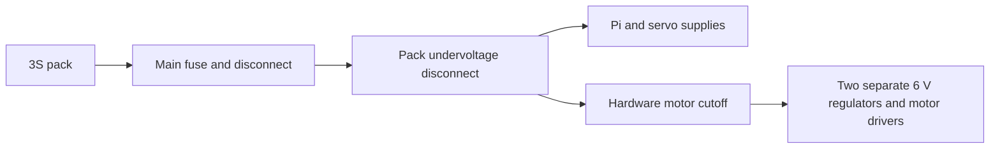

# Wiring draft — engineering review required

This diagram shows the intended architecture. It is not a validated electrical schematic. Do not wire or energize the robot from this diagram alone.

## Power architecture

The selected assembled 3S battery reaches 12.6 V fully charged. A suitably rated fuse, disconnect, automatic low-voltage protection and hardware drive isolation must be specified before the power distribution is finalized. The current emergency-stop candidate is not approved to interrupt battery current directly.

The revised power design budgets two independent 6 V motor rails, one per MDD3A, plus separate supplies for the servos and Raspberry Pi. Each motor rail uses one Pololu D36V50F6 and serves two Adafruit 3777 motors. At the vendor's measured 1.5 A stall per motor at 6 V, that is 3 A per rail compared with the regulator's typical 5.5 A rating. Treat this as a sizing estimate. Verify the regulator's available current across pack voltage and operating temperature, plus startup transients and supply faults. Keep the two 6 V positives separate. Use a common signal-ground reference. Battery protection, hardware drive isolation, wiring ratings, and hardware testing remain open.

- Front regulator output → driver 1 VB+ and VB− via its own positive and return.
- Rear regulator output → driver 2 VB+ and VB− via its own positive and return.
- The raw battery supply stays upstream of both regulators and their pending protection. Keep the drive unpowered until protection and wiring have been reviewed.

[Adafruit motor measurements](https://www.adafruit.com/product/3777) · [Pololu regulator specs and current curves](https://www.pololu.com/product/4092)

The Pi supplies HDMI to the display, USB for touch/audio, CSI for the camera and USB data to the Pico. Confirm total USB power demand. Avoid backfeeding power through USB during external-power development. The design now specifies the official Raspberry Pi Pico 2 with Headers (SC1632), using a USB-A to Micro-B data cable for the Pi-to-controller link.

## Battery protection and motor cutoff design draft

- **Main protection:** Put the DC-rated fuse near the battery positive terminal, ahead of downstream distribution. Select it after checking the pack fault current, interrupt rating, normal and startup loads, and the weakest protected wire or connector. Review branch protection where wire ratings decrease.
- **Undervoltage:** Specify automatic disconnect based on the exact pack manufacturer's discharge limits. Verify how the device handles an individual weak cell, voltage sag, and reconnect behavior. A buzzer can alert the operator. The protection requirement is automatic disconnection.
- **Motor cutoff:** Use a latching stop control to drop a normally open, DC-rated switching device feeding both motor regulators. Keep the Pico outside the stop control path. Releasing the stop must require a separate deliberate re-arm before motion can resume. Verify switching and inrush ratings, suppression, and actual stopping behavior. The motor cutoff leaves the Pi and servo supplies live while pack protection is active. Use the main disconnect for whole-robot isolation.
- **Bench acceptance:** With the wheels off the ground, verify that the cutoff works with the controller unresponsive, that releasing it does not cause motion, and that a simulated undervoltage event disconnects the downstream loads. Confirm acceptable stop time with the final hardware.

The block diagram records the proposed architecture. Exact protection parts, wiring ratings, and test results are pending. Keep the robot unpowered until the design has been reviewed.

[DC fuse selection guidance](https://www.bluesea.com/support/articles/Circuit_Protection/98/DC_Circuit_Protection) · [LiPo safety example](https://www.horizonhobby.com/on/demandware.static/-/Sites-horizon-master/default/dwf466d0fb/Manuals/Reedy-LiPo-Manual-MULTI.pdf)

### Protection parts screening

The Venom 15190 listing specifies a 3S1P pack, 12.6 V maximum, 9 V minimum pack voltage and 14 AWG pack leads. Use the published minimum as a screening boundary. The final cutoff threshold needs cell-level monitoring and margin for load sag. The pack lead gauge does not establish the capacity of downstream wiring.

At the modeled simultaneous motor stall, the four motors draw approximately 36 W at the 6 V rails. The Pi regulator's 5 V × 5 A output rating adds up to 25 W. That is 61 W before servos. For a sizing example only, at 9 V input and 85% assumed conversion efficiency, those two loads would draw about 8.0 A upstream. Servo startup, relay coil draw, conversion variation, inrush and wiring losses are extra. Retain the 10 A fuse as a provisional BOM entry until the current profile, fuse time-current curve, DC interrupt capacity and weakest wire or connector are checked.

| Candidate | Screening result |
|---|---|
| Victron Smart BatteryProtect 65 A | Pack-voltage disconnect candidate. Keep off the purchasing list until a compatible individual-cell protection input and restart behavior are verified. Its pack-voltage settings alone cannot detect a weak cell in a 3S pack. |
| Omron/Aratas G8JN-1C6T-DC12 relay | Candidate only for the normally open drive cutoff. Datasheet resistive load rating does not establish suitability for two buck converters' DC input inrush. Verify the exact relay, socket, suppression, load profile and re-arm circuit before selection. |
| Existing cell buzzer | Optional warning device. Automatic isolation remains a separate requirement. |

[Venom pack limits](https://venombattery.com/product/50c-3s-2200mah-11-1v-rc-rock-crawler-lipo-battery-with-universal-plug/) · [Pi regulator output rating](https://geekworm.com/products/yb-mpp01) · [Victron BatteryProtect](https://www.victronenergy.com/battery_protect/smart-battery-protect) · [G8JN relay datasheet](https://omronfs.omron.com/en_US/ecb/products/pdf/en-g8jn.pdf)

### Protection component shortlist

| Function | Exact candidate | Remaining check |
|---|---|---|
| Manual whole-robot disconnect | Littelfuse 75920-01, 36 V series | Check the switch's mounting envelope, terminal hardware, and delivered price. This is a manual disconnect. |
| Hardware cutoff for both drive regulators | Omron/Aratas G8JN-1C6T-DC12, normally open contact | Qualify the relay and socket for the combined regulator input inrush, actual DC interruption duty, and minimum loaded coil voltage. Verify manual re-arm and power-loss behavior. |
| Automatic battery disconnect | Victron Smart BatteryProtect 65 A, conditional | Requires a compatible weak-cell protection signal and a load path matched to the downstream inrush. Victron advises controlling a remote enable for high-inrush loads. Verify that the final design actually isolates the downstream loads and stays off after low-voltage recovery until deliberately re-armed. |

The reviewed 20 A 3S protection board is specified as auto-recovering. The selected battery is a preassembled pack, so retain its factory wiring. Screen a compatible external weak-cell monitor and shutdown interface as a pair. The parts above remain candidates pending these checks and are excluded from the priced BOM.

[Manual disconnect listing](https://www.digikey.com/en/products/detail/littelfuse-commercial-vehicle-products/75920-01/27496177) · [Drive relay listing](https://www.digikey.com/en/products/detail/omron-electronics-inc-emc-div/G8JN-1C6T-DC12/252469) · [BatteryProtect manual](https://www.victronenergy.com/upload/documents/BatteryProtect_12V_24V/114439-Smart_BatteryProtect-pdf-en.pdf)

### Regulator inhibit and external cell-monitor review

Pololu documents an active-low EN input on the D36V50F6. This gives the two drive regulators a hardware inhibit input that can be evaluated for a secondary stop path. The board is enabled by default. A broken inhibit wire must therefore be considered during design review. Regulator inhibit alone does not establish battery isolation, and the output voltage and wheel stop behavior after disabling still need measurement.

The Junsi CellLog 8S manual documents individual cell monitoring and an alarm output. It is a candidate for evaluating the external weak-cell signal. Keep it off the purchase BOM until current sourcing and the output behavior on alarm, power loss, and balance-plug removal are verified. The final cutoff must latch off after a fault, require deliberate re-arm, and remain independent of the Pico. Keep the hardware drive cutoff and manual whole-robot disconnect as separate functions pending qualification.

[Pololu regulator connections](https://www.pololu.com/product/4092#connections) · [Junsi CellLog 8S manual](https://www.manualslib.com/manual/1979403/Junsi-Celllog-8s.html?page=2)

### Servo current and wire screening

The exact TD8120MG listing identifies a reseller specification of 3.1 A stall at 7.4 V. A verified 6 V stall rating is still needed. For sensitivity only, budgeting 3.1 A per servo at the 6 V rail gives 6.2 A for the pair, above the shared regulator's typical 5.5 A rating. Combined with the earlier 61 W motor and Pi example, that gives about 12.8 A at 9 V input and 85% assumed efficiency before inrush. These are screening scenarios. Obtain the vendor's 6 V data or measure startup and brief peak demand with a current-limited bench supply and the final linkage before selecting the servo regulator and fuse.

| BOM wire or lead | Proposed use and check |
|---|---|
| 14 AWG battery pack leads | Check the mating adapter, fuse holder, disconnect and every downstream conductor independently. |
| 16 AWG fuse-holder pigtails and 1.0 mm² chassis cable | Candidate power wiring. Check supplier ampacity, insulation, bundling, round-trip length and voltage drop at the actual load. The fuse holder's current rating alone does not qualify its leads. |
| 22 AWG signal wire and servo extensions | Keep signal wiring separate from main power. Verify extension contact rating and voltage drop for each servo. |
| Motor leads and 18 AWG spade leads | Check the actual motor lead gauge and the terminal rating. Reserve the spade leads for an identified terminal with a verified fit and rating. |

Keep the 10 A fuse and shared servo regulator provisional. Do not increase the fuse rating until the complete protected path and fault interrupt rating have been checked.

[TD8120MG reseller specification](https://www.mantech.co.za/datasheets/products/td8120mg-220871.pdf) · [DC wire sizing guidance](https://www.bluesea.com/support/reference/535/Voltage_Drop_in_Conductor_-_Wire_Sizing_Chart)

### Head servo alternative

Hitec's D950TW has published 6 V figures: 29 kgf·cm stall torque and 4.8 A stall current per servo. Its case is 40 × 20 × 38 mm with a 25T spline and programmable travel up to 175°. Two units can reach 9.6 A at 6 V under simultaneous stall. That rules out the shared 5.5 A regulator for this option. Even with one existing regulator per servo, 4.8 A leaves little margin against the typical 5.5 A rating, which varies with input and thermal conditions.

Keep the TD8120MG entries provisional. Consider the D950TW if the current specification for the original servo remains unavailable and after checking bracket fit, required holding torque, travel, price and a suitable power supply. Estimate tilt torque from the mass of the moving head and its balance-point offset from the tilt axis, including cable drag and motion loads. Use an operating torque target below stall torque. Verify the actual servo supply and connector peaks on the bench before selecting the fuse.

[Hitec D950TW specification](https://www.hiteccs.com/public/uploads/data_sheet/HCS_D950TW_Specsheetv2.2_102-1729876661.pdf)

### CAD-based head tilt load estimate

The current STEP models a servo envelope but does not locate a final shaft axis. For this estimate, assume a left-to-right tilt axis through the envelope center at Y = 39 mm and Z = 165 mm. Lever arms below use the distance from that axis in the Y–Z plane, so their sum bounds static gravity torque over the full tilt range under these assumptions.

| Moving item | Estimated mass | Lever arm | Static torque bound |
|---|---:|---:|---:|
| Head shell, 41.02 cm³ of PETG | 52.1 g | 48.1 mm | 0.251 kgf·cm |
| Camera carrier and head adapter, 4.35 cm³ of PETG | 5.5 g | Calculated separately for each part | 0.021 kgf·cm |
| Camera and lens allowance | 10 g | 50 mm | 0.050 kgf·cm |
| Fasteners, moving bracket hardware and cable mass allowance | 15 g | 60 mm | 0.090 kgf·cm |
| Total | 82.6 g | | 0.41 kgf·cm (0.040 N·m) |

Printed part estimates use solid PETG at 1.27 g/cm³. The camera and hardware entries are allowances. A preliminary tilt screening target of about 1.25 kgf·cm (0.12 N·m) gives roughly three times the modeled static torque. This target is for usable operating torque. Check the physical shaft location, moving bracket mass, cable drag, acceleration and binding before selecting a servo. Pan needs a separate check because this gravity estimate applies to the tilt axis.

The modeled gravity load does not justify choosing a 29 kgf·cm stall-torque servo by itself. No servo part or price is changed by this estimate.

[PETG density reference](https://prusament.com/wp-content/uploads/2022/10/PETG_Prusament_TDS_2021_10_EN.pdf)

### Lower-current head servo and pan screening

The Hitec D645MW (36645S) is a metal-gear tilt candidate. At 6 V, Hitec lists 2.15 A stall current, 11.3 kgf·cm stall torque, and 2.3 kgf·cm torque at peak efficiency. The last figure exceeds the preliminary 1.25 kgf·cm tilt target and supports shortlisting it. Check the mounting drawing, 25T horn fit, available travel, and actual loaded motion before purchase. The servo supports positional travel up to 175°. The design still needs a separate decision if full 360° pan is required.

For pan, an upright vertical axis has no static gravitational moment about the axis. Screen acceleration separately from bearing friction, cable drag, and any load from axis misalignment. As an illustrative upper-inertia case, put an assumed 0.20 kg of rotating assembly at a radius of 0.080 m. Then I ≤ 0.00128 kg·m² for that mass and radius. At an assumed 8 rad/s², the inertial torque is about 0.010 N·m (0.10 kgf·cm). This excludes friction and cable drag. Weigh the rotating hardware, check its radial extent and desired acceleration, then measure breakaway torque with the camera cable routed before choosing the pan actuator. A continuous-rotation servo alone does not provide absolute angle positioning.

If limited pan travel is acceptable and a pair of D645MW servos fits, their published simultaneous stall estimate is 4.30 A at 6 V. This is below the existing regulator's typical 5.5 A rating on paper. Check actual regulator capacity at the intended pack voltage and cooling, plus transient response and connector ratings. With the earlier 61 W motor and Pi load example, the pair adds 25.8 W, or about 11.35 A upstream in total at 9 V and 85% assumed efficiency, excluding inrush. Keep the fuse and servo supply provisional. Retain the existing BOM pending pan travel, fit, and supplier availability.

[Hitec D645MW specification](https://www.hiteccs.com/public/uploads/data_sheet/HCS_D645MW_Specsheetv2.2_102-1729815560.pdf) · [Hitec product page](https://hitecrcd.com/d645mw-high-torque-metal-gear-25T-digital-sport-servo/)

### Full-turn pan option

Keep 360° commanded pan as the design goal. A position-feedback candidate is the metal-gear ROBOTIS DYNAMIXEL XM430-W210-T. Its 12-bit magnetic encoder resolves one revolution into 4096 counts. Extended position mode can command across the single-turn boundary. The actuator uses a half-duplex TTL serial bus and needs a compatible interface, a revised mount and separate power. ROBOTIS specifies 10–14.8 V operating input and 2.3 A stall current at 12 V. The planned 6 V servo rail is outside that range, and the battery voltage can fall below 10 V. Evaluate a dedicated regulated supply, control interface and power budget before committing to this actuator.

For a one-turn sweep with the existing Camera Module 3 and a stationary Pi, evaluate a guided flex-cable loop that unwinds by reversing. Set software limits inside a physically verified free travel range and check strain relief and clearance at both ends. Until tested, the cable path and full-turn range remain open. Repeated same-direction turns require a different camera and tilt wiring architecture or a rotary interface qualified for those signals. The existing camera ribbon carries MIPI CSI-2. An ordinary power slip ring has no established compatibility with that link.

Keep the Hitec D645MW as the limited-angle tilt candidate. The pan and tilt alternatives stay outside the order BOM pending mount fit, cable travel, power and sourcing.

[ROBOTIS actuator specifications](https://en.robotis.com/service/selection_guide4.php) · [Operating modes](https://emanual.robotis.com/docs/en/dxl/x/xm430-w210/) · [Camera Module 3 schematic](https://pip-assets.raspberrypi.com/categories/1207-design-files/documents/RP-008969-SD-3-Raspberry%20Pi%20Camera%20Module%203%20Reference%20Schematic.pdf)

### Camera ribbon routing and travel check

The STEP has a nominal 19 × 5 mm opening cut into the head floor. Its center is about 25 mm from the modeled pan axis in plan view. The pan shaft is modeled as a solid placeholder. Use an external route alongside the neck for this layout. Verify that the actual cable end can pass through the opening and that the edge and nearby bracket leave room for the cable to exit without pinching.

Route the Camera Module 3 ribbon from the head-floor opening to a moving strain-relief point above the pan joint. Allow tilt slack between the head and that point. Below it, reserve an external service loop between the moving neck and a fixed chassis-side anchor. From the fixed anchor, route toward the stationary Pi tray. Keep the loop clear of the shaft, bracket, wheels and head motion.

**CAD length check.** The head exit is at approximately (24.5, 29.5, 185) mm and the Pi board envelope spans X = −42.5 to 42.5 mm, Y = −53 to 3 mm at Z = 84 mm. The nearest point on that board envelope is about 104 mm away in a straight line. This is a lower bound for the external run and excludes the internal head run. For an illustrative right-angle route, the drop to board height (101 mm), the fore-aft run toward the board (27–83 mm), and a possible centerline-to-edge run (up to 68 mm from the exit X coordinate) give about 128–252 mm before detours or slack. The actual CSI connector location is absent from the CAD envelope.

For a loop centered on the modeled pan axis, a 25 mm radius sweeps about 79 mm of arc from neutral to either 180° endpoint. Use this as a space-planning example, since loop shape and slack payout depend on the anchors. Adding that allowance to the sample external routes gives about 207–331 mm before tilt slack, the internal run and connector strain relief. The 300 mm BOM cable is plausible for a short route but has no demonstrated margin for a full turn. Mock up 300 mm and 500 mm lengths before changing the BOM, and check whether the extra length can be restrained without reaching the wheel or joint.

| Check | Method |
|---|---|
| Length | With a paper strip or flexible mock-up, trace both strain-relief points, the fixed run and the loops. Compare the measured route at every extreme with the BOM's 300 mm cable. Raspberry Pi lists 200, 300 and 500 mm versions of the Standard–Mini cable. |
| Travel | With power off, start at neutral and move the head toward each pan endpoint, checking both tilt extremes at each end. Stop before the cable binds, rubs or pulls a connector. Record the smallest clearance and the actual available angular range. Set software limits inside that verified range. |
| Signal | After the mechanical checks and electrical review, verify the live camera feed through repeated sweeps and reversals. Check for dropouts and connector movement. |

The final shaft, strain reliefs, cable bend radius and achievable sweep still need a mock-up. Keep 360° as the goal until that test establishes the range. The prototype may need a revised exit or a longer ribbon.

[Raspberry Pi camera cable options](https://www.raspberrypi.com/products/camera-cable/)

### Pan mount clearance and mock-up

The STEP places the pan-axis placeholder at X = 0, Y = 28 mm. At neutral tilt, the head shell's bounding box extends 40 mm sideways and 20 mm fore and aft from that axis. Its corners therefore sweep within a radius of about 45 mm. The camera lens envelope lies within that radius. Reserve a roughly 90 mm diameter sweep zone for the shell at neutral tilt. The estimate excludes the ribbon, brackets and any change in the swept volume during tilt.

The existing pan servo envelope is 40 × 20 × 35 mm. The provisional XM430-W210-T body measures 28.5 × 46.5 × 34.0 mm. The existing envelope cannot contain that body with its faces aligned to the envelope. Use the actuator mounting drawing to lay out a new bracket around the pan axis, allowing access for fasteners and the connector. The current STEP does not establish fit for this actuator.

For a power-off mock-up, mark the axis and sweep circle on a plan view, place a cardboard template of the actuator and connector at the intended mount, and trace both the 300 and 500 mm ribbon paths. Sweep from neutral toward both endpoints at minimum, neutral and maximum tilt. For each combination, record reach, smallest clearance, snag points and whether reversing returns the cable to neutral without a twist. Use the observed clear range to set initial travel limits. Keep actuator and ribbon choices provisional until fit and motion are checked.

[ROBOTIS dimensions and ratings](https://en.robotis.com/service/selection_guide4.php)

### XM430 pan mount layout

| Interface | Layout |
|---|---|
| Shaft datum | Keep the output axis vertical at X = 0, Y = 28 mm. Use the existing Z = 149 mm neck plate top as the fixed-side datum. |
| Fixed side | Lay out an adapter on the 50 × 35 mm neck plate, with the actuator's 46.5 mm body dimension along the 50 mm direction. Center the **output axis** using the ROBOTIS drawing. The body may overhang because the axis and body midpoint differ. Check that the adapter spreads the load onto the neck plate. |
| Moving side | Mate the output horn to an adapter that carries the tilt assembly. The existing head-adapter underside at Z = 182 mm is a reference elevation. Check the full horn, bracket and fastener stack before deciding whether the head must sit higher. |
| Cable clearance | Keep the actuator's stationary power and data leads on the fixed side. Leave the external camera and tilt cable loop clear of the output horn and bracket. Check access for the connector plug and mounting screws at assembly. |

The 46.5 × 28.5 mm body fits inside the neck plate's footprint only when comparing centered rectangles. That comparison leaves 3.5 mm and 6.5 mm total clearance along the two dimensions and does not include the output-axis offset, mounting tabs or connector. Use the vendor STEP and frame drawings to locate the actual holes and check the stacked assembly with the head at both tilt extremes. This is a layout for CAD placement. Hole locations, stack height and the attainable sweep are still open.

**Envelope stack check.** The neck plate top is at Z = 149 mm and the underside of the current head adapter is at Z = 182 mm. That leaves 33 mm. In the proposed orientation with the 46.5 × 28.5 mm faces parallel to the neck plate, the published 34 mm overall envelope exceeds that space by 1 mm even before reserving room for external mounting and fasteners. Allow for a raised head or a recessed mount and verify the actual horn datum and stack with vendor CAD. The official actuator and hinge-frame download links returned 404 pages during this check. Shaft offset, overhang and connector access still require the actual vendor geometry.

[ROBOTIS XM430 and compatible frame drawings](https://emanual.robotis.com/docs/en/dxl/x/xm430-w210/#drawings)

## Proposed logical GPIO allocation

These physical pin numbers are for the official Raspberry Pi Pico 2 with Headers (SC1632). Identify the board orientation using the [official pinout](https://pip-assets.raspberrypi.com/categories/1005-raspberry-pi-pico-2/documents/RP-008301-DS-1-Pico-2-Pinout.pdf?disposition=inline) and confirm the labels on the purchased hardware.

| Function | Input A | Input B |
|---|---|---|
| Front-left motor, driver 1 channel 1 | GP2 (pin 4) | GP3 (pin 5) |
| Front-right motor, driver 1 channel 2 | GP4 (pin 6) | GP5 (pin 7) |
| Rear-left motor, driver 2 channel 1 | GP6 (pin 9) | GP7 (pin 10) |
| Rear-right motor, driver 2 channel 2 | GP8 (pin 11) | GP9 (pin 12) |

The MDD3A uses two control inputs per motor. This starter uses one PWM input at a time for forward/reverse; it does not assume a PWM/DIR interface. Actual wheel polarity and correct left/right wheel placement must be calibrated with the robot lifted.

GP10/GP11 are reserved for future pan/tilt signals, and GP12/GP13 for future ultrasonic trigger/echo. No servo or ultrasonic implementation is included in this drive starter. Do not feed a 5 V echo directly into 3.3 V GPIO: the exact level-conversion circuit remains to be designed and verified. GP14 is reserved for a future hardware-interlock status input; reading that input in software would not itself provide a hardware stop.

## Motor driver 1 — front wheels

| Controller or motor connection | Cytron MDD3A driver 1 |
|---|---|
| Controller GP2 (pin 4) | M1A signal input |
| Controller GP3 (pin 5) | M1B signal input |
| Controller GP4 (pin 6) | M2A signal input |
| Controller GP5 (pin 7) | M2B signal input |
| Controller signal ground (Pico 2 pin 8) | GND on the signal header |
| Front-left motor, two leads | Motor 1 output terminal pair |
| Front-right motor, two leads | Motor 2 output terminal pair |
| No connection | 5VO |
| Motor supply positive and return | VB+ and VB− respectively, proposed separate 6 V rail, pending protection and bench verification |

Confirm the hardware matches the selected SC1632 and the pin numbers above. Keep the hardware unpowered until the power design and protection are verified.

[Cytron MDD3A datasheet, board layout and functions](https://www.electrokit.com/upload/product/41018/41018266/MDD3A%20Datasheet.pdf)

## Motor driver 2 — rear wheels

| Controller or motor connection | Cytron MDD3A driver 2 |
|---|---|
| Controller GP6 (pin 9) | M1A signal input |
| Controller GP7 (pin 10) | M1B signal input |
| Controller GP8 (pin 11) | M2A signal input |
| Controller GP9 (pin 12) | M2B signal input |
| Controller signal ground (Pico 2 pin 8) | GND on the signal header |
| Rear-left motor, two leads | Motor 1 output terminal pair |
| Rear-right motor, two leads | Motor 2 output terminal pair |
| No connection | 5VO |
| Motor supply positive and return | VB+ and VB− respectively, proposed separate 6 V rail, pending protection and bench verification |

Use the same controller pinout and power checks listed for driver 1 before connecting or powering the hardware.

## Unresolved before operation

- Battery cutoff thresholds and circuit, hardware stop, fuse and switch ratings at 12.6 V.
- Motor regulator bench validation, cable ratings, connectors, grounding and power sequencing.
- Physical board identity, safe startup levels, wheel polarity and mecanum orientation.
- Ultrasonic level conversion, sensor failure behavior, servo rail and mechanical travel limits.
- Complete pin-to-pin schematic, connector numbering and power budget.

References: [Cytron manufacturer library](https://github.com/CytronTechnologies/CytronMotorDriver) documents the MDD3A-compatible PWM/PWM mode; [Raspberry Pi microcontroller documentation](https://www.raspberrypi.com/documentation/microcontrollers/) covers supported official boards. The pin assignments above apply to the official Pico 2.
