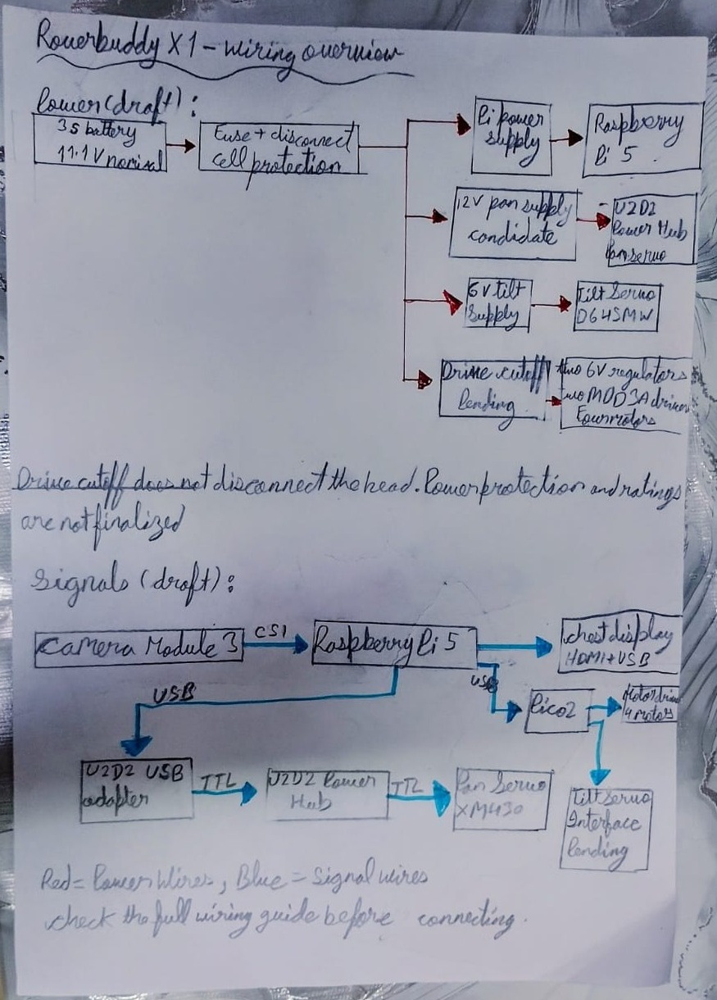
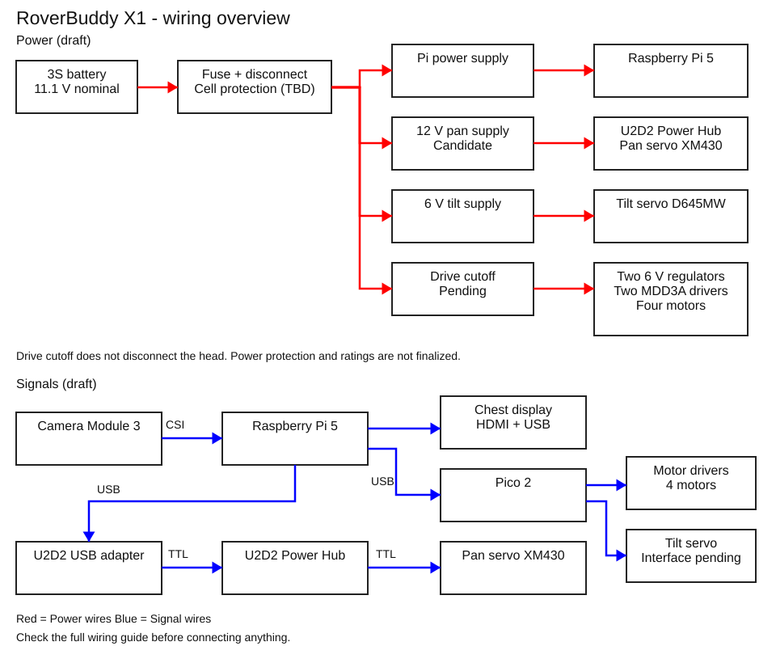

# Wiring

## Digital reference

Red lines show power. Blue lines show signals. Both drawings are overview drafts. The GPIO table below adds the planned ultrasonic sensor connections and tilt signal that are missing from the drawings. This is a draft. Keep power and actuators off until a qualified adult has checked the complete electrical setup.

## How the parts connect

- Pi 5 handles the camera and screen. Pico 2 handles the proposed drive controls.
- The two motor drivers each control two wheels.
- The distance sensor is planned to detect nearby obstacles.
- The battery needs protection, suitable regulated supplies and an independent hardware stop. The proposed drive cutoff does not shut off the head.

## Current pan and tilt wiring plan

| Part | Planned connection |
| --- | --- |
| Pan servo (XM430-W210-T) | Pi USB to U2D2 and Power Hub over the TTL bus. Separate regulated 12 V supply is proposed. |
| Tilt servo (D645MW) | Pico PWM through an interface that still needs checking. Separate 6 V supply is proposed. |
| Camera Module 3 | 500 mm Standard–Mini camera cable to Pi 5. |

Check the actual servo interface, cable length, power rating, grounding and startup behavior before connecting. The U2D2 USB connection does not power the actuator, and the Power Hub does not regulate voltage.

## Proposed Pico GPIO assignments

| Function | GPIO |
| --- | --- |
| Front left | GP2, GP3 |
| Front right | GP4, GP5 |
| Rear left | GP6, GP7 |
| Rear right | GP8, GP9 |
| Tilt PWM (reserved) | GP11 |
| Ultrasonic trigger (reserved) | GP12 |
| Ultrasonic echo (reserved, level conversion pending) | GP13 |
| Interlock status (reserved) | GP14 |

The sensor echo needs verified level conversion before it can connect to the 3.3 V GPIO. Only drive control is implemented in the Pico starter. The actual pin labels, wheel directions, driver and power circuit still need checking.

## Before building

Use the [build checklist](build-checklist.md). The [full wiring reference](https://github.com/Umair-Coder124/RoverBuddy-X1-verified/blob/d836ea650516e329bdd500ddd6cfbd0f682dbf04/docs/WIRING.md) includes detailed terminal mappings, power calculations, battery protection options, source links and outstanding electrical checks. It is a design reference and still needs qualified review.
